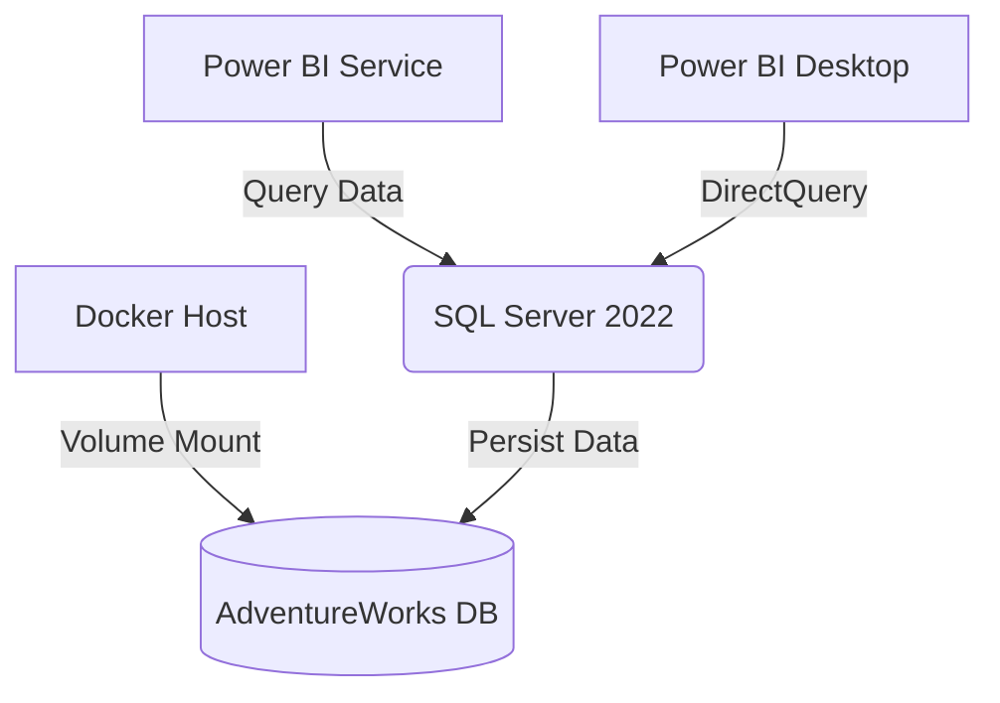

# AdventureWorks Data Sandbox

A containerized SQL Server environment with Power BI integration for data analysis and reporting.

## Prerequisites

- **Docker Desktop** ([Windows](https://docs.docker.com/desktop/install/windows-install/) | [Mac](https://docs.docker.com/desktop/install/mac-install/))
- **PowerShell 7+** ([Download](https://aka.ms/powershell-release?tag=stable))
- **Power BI Desktop** ([Download](https://powerbi.microsoft.com/desktop/))
- AdventureWorks2019.bak file ([Download](https://github.com/Microsoft/sql-server-samples/releases/download/adventureworks/AdventureWorks2019.bak))

## Quick Start

### 1. Clone Repository
```powershell
git clone https://github.com/eko-sandbox/eko-sandbox.git
cd eko-sandbox
```

### 2. Initialize Environment
```powershell
# Create directories
mkdir backups, powerbi-automation

# Place AdventureWorks backup in backups folder
mv ~/Downloads/AdventureWorks2019.bak ./backups/
```

### 3. Start Containers
```powershell
docker-compose up -d
```

### 4. Verify Database
```powershell
docker exec -it eko-sandbox-sql-server-1 \
  /opt/mssql-tools/bin/sqlcmd -U sa -P "YourStrong!Passw0rd123#" \
  -Q "SELECT name FROM sys.databases WHERE name = 'AdventureWorks2019'"
```

## Power BI Configuration

### 1. Create Workspace & Dataset
```powershell
cd powerbi-automation
.\workspace-setup.ps1 `
    -WorkspaceName "AdventureWorks_Sandbox" `
    -AdminEmail "your-email@company.com" `
    -SqlConnectionString "Server=localhost;Database=AdventureWorks2019;User ID=analyst;Password=P@ssw0rd;"
```

### 2. Connect Power BI Desktop
1. Open Power BI Desktop
2. **Get Data** → **SQL Server**
   ```
   Server: localhost
   Database: AdventureWorks2019
   ```
3. Use credentials:
   ```
   User: analyst
   Password: P@ssw0rd
   ```

### 3. Publish Sample Report
1. Build report using `Person.Person` and `Sales.SalesOrderHeader` tables
2. **Publish** → Select "AdventureWorks_Sandbox" workspace

## Troubleshooting

### Common SQL Server Issues


**Error**: `Cannot open backup device`  
**Fix**:
```powershell
# Verify file permissions
icacls ".\backups" /grant "Everyone:(OI)(CI)F"
```

### Power BI Issues

**Error**: `Module conflicts`  
**Fix**:
```powershell
# Close all PowerShell sessions
Get-Process powershell | Stop-Process -Force

# Clean install modules
Install-Module -Name MicrosoftPowerBIMgmt -Force -AllowClobber
```

**Error**: `Dataset refresh failed`  
**Verify Connection**:
```powershell
Test-NetConnection localhost -Port 1433
```


## Architecture



## Recommended Resources

- [AdventureWorks Sample Reports](https://github.com/microsoft/powerbi-desktop-samples)
- [Power BI REST API Docs](https://learn.microsoft.com/en-us/rest/api/power-bi/)
- [SQL Server Linux Tips](https://learn.microsoft.com/en-us/sql/linux/sql-server-linux-overview)

---

**Maintainer**: Doug <doug@p42systems.com>  
**Last Updated**: {{DATE}}